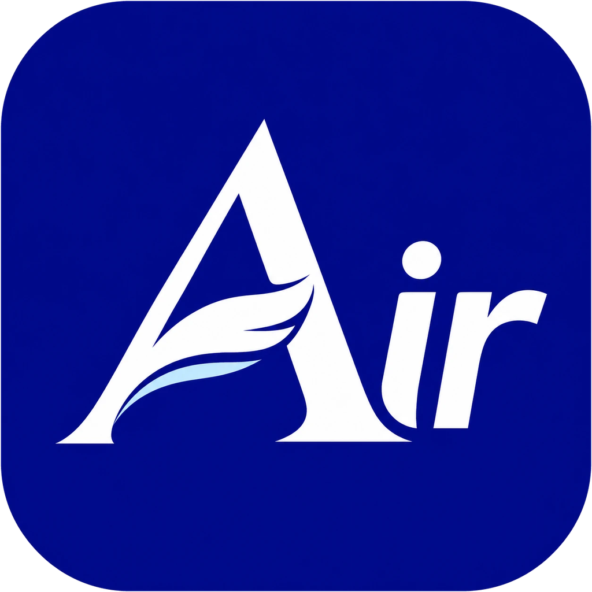

<p align="center"></p>
<p align="center"></p>

# Air PDF

> **문서는 가볍게, 작업은 자유롭게**

빠르게 열리는 PDF **뷰어**와, 필요할 때만 켜는 **편집기**를 하나로 묶은 프로그램입니다.
같은 코드로 **웹**과 **Windows** 설치판을 만듭니다 (macOS·Linux는 추후).

- 엔진: **PDFium** (크롬이 쓰는 PDF 엔진)을 WebAssembly로 돌립니다. 모든 처리는 내 컴퓨터 안에서 하고, 파일을 서버로 보내지 않습니다.
- 데스크톱: **Tauri 2**. Electron과 달리 브라우저를 통째로 싣지 않고 운영체제의 WebView2를 써서 가볍습니다.

## 받기

| 운영체제 | 파일 |
|---|---|
| Windows 10/11 | [`release/AirPDF_0.8.0_x64-setup.exe`](release/AirPDF_0.8.0_x64-setup.exe) — 누른 뒤 오른쪽의 다운로드(↓) 단추 |
| 웹 | `npm run build`로 만든 `dist/` 폴더를 아무 정적 웹 서버에 올리면 됩니다 (아래 “웹판을 바로 쓸 수 있게 올리기”) |
| macOS · Linux | 추후 지원 |

한 번 설치하면 다음부터는 **자동 업데이트**됩니다: 켤 때 새 버전을 확인하고, 오른쪽 아래 “지금 업데이트”를 누르면 받아서 다시 시작합니다(메뉴 ⋯ → 업데이트 확인). 업데이트 파일은 서명을 확인한 뒤에만 설치합니다.

> 자동 업데이트는 저장소가 **공개(Public)**일 때 동작합니다. 앱은 먼저 저장소의 [`release/latest.json`](release/latest.json)을, 없으면 GitHub Releases의 `latest.json`을 확인합니다. 새 버전을 내보낼 때는 서명 키로 빌드한 뒤 `node scripts/make-latest.mjs "바뀐 점"`으로 이 파일을 고쳐 설치 파일과 함께 올리면 됩니다.

설치 파일은 코드 서명이 되어 있지 않아 Windows에서 처음 실행할 때 “Windows의 PC 보호” 창이 뜹니다. **추가 정보 → 실행**을 누르면 설치됩니다.

## 보기 모드와 편집 모드

| | 보기 모드 (기본) | 편집 모드 (`Ctrl+E`) |
|---|---|---|
| 불러오는 코드 | 화면 약 70KB + 엔진 | 편집 도구 48KB를 **처음 켤 때만** 추가로 불러옴 |
| 마우스 | 글자 끌어 선택·복사, 빈 곳 끌어 넘기기, 링크 누르기 | 고르고 옮기기, 글자 고치기, 그리기 |
| 화면 | 도구줄 한 줄, 탐색 패널 | 주황 띠 + 편집 리본(편집·주석·페이지·도구) + 주석 목록 |

보기 모드는 SumatraPDF처럼 가볍게 쓰도록 만들었습니다. 보이는 쪽만 화면에 만들고(가상 목록), 보이는 쪽부터 그리며, 크게 확대하면 화면에 보이는 부분만 높은 해상도로 따로 그립니다.

## 기능

**보기**
- 이어 보기 / 두 쪽씩 보기, 너비·쪽 맞춤, `Ctrl+휠` 확대(마우스 위치 기준), 야간 보기(색 반전)
- 쪽 그림, 목차(책갈피), 문서 안 링크와 웹 주소 링크
- 찾기: 전체 문서, 대소문자·낱말 단위, 결과 목록과 앞뒤 문맥, `F3`
- 글자 선택(여러 쪽 걸쳐서도), 두 번 누르면 낱말, 세 번 누르면 줄 선택, `Ctrl+C`
- **암호 걸린 PDF**: 암호를 물어보고 엽니다. 틀리면 다시 묻습니다. 저장하면 같은 암호가 유지됩니다
- 인쇄, 전체 화면(위쪽 줄은 숨었다가 마우스를 맨 위에 대면 나타남, 창 단추의 최대화 자리가 '전체 화면 끝내기'가 됨, `Esc`로 끝내기), 문서 정보, 단축키 안내(`F1`)
- **최근 문서**(설치판): 시작 화면과 … 메뉴 → 최근 문서(`Alt+R`)에서 찾아 열기·목록에서 빼기. 설정에서 기록 켜고 끄기, 기간(7일~1년·무제한), 개수(10개~100개·무제한)
- 글꼴을 넣지 않은 한글 PDF(바탕·굴림·HY… 이름만 적힌 파일)도 대체 글꼴로 제대로 보입니다

**탭**: 여러 PDF를 탭으로 열고(`Ctrl+Tab`으로 바꾸기, `Ctrl+W`로 닫기) 탭마다 보던 쪽·배율·되돌리기 기록을 따로 기억합니다. 데스크톱에서는 프로그램이 켜져 있을 때 탐색기에서 PDF를 더블클릭하면 새 창 대신 탭으로 열립니다. 탭은 끌어서 순서를 바꾸고, 설치판에서는 창 밖으로 끌어 놓으면 새 창으로 떼어 내고 다른 창의 탭 줄에 놓으면 그 창으로 합칩니다.

**탐색 패널**: 왼쪽 가장자리의 얇은 줄(레일)에서 페이지·목차·찾기 결과·주석을 누르면 패널이 열리고, 같은 것을 다시 누르면 닫힙니다(`F12`). 목차는 목차가 있는 문서에서만, 찾기 결과는 찾았을 때만 나옵니다. 전체 화면에서도 레일이 남아 있어 패널을 켜고 끌 수 있고, 도구줄이 내려와도 가려지지 않습니다.

**막대**: 위쪽 막대는 열기·저장·찾기·모드만 두고 나머지 빈 곳(로고·문서 이름 포함)을 잡아 창을 끌 수 있습니다. 페이지 이동·배율·확대/축소·너비/전체 맞춤은 아래 막대 오른쪽에 있습니다.

**입력란(양식) 채우기**: 보기 모드에서도 칸을 눌러 바로 입력합니다. 글자칸(한 줄·여러 줄), 확인란, 단일 선택, 콤보, 목록을 지원하고 `Tab`으로 다음 칸으로 갑니다. 한글 값은 입력란 모양을 글자 윤곽선(벡터)으로 직접 그려 넣어서, 이 앱뿐 아니라 다른 PDF 프로그램과 인쇄에서도 한글이 보입니다. 값 자체는 진짜 글자로 저장됩니다.

**편집 → 원본 PDF 직접 수정** (모두 PDF 안의 진짜 객체로 들어가고, 이미지로 바꾸지 않습니다)
- **양식(Form XObject) 안 글자도 고칩니다**: 다른 프로그램이 만든 PDF는 쪽 내용 전체나 머리글이 '양식' 상자 안에 들어 있는 경우가 많습니다. 그런 글자도 원래 글꼴·크기·위치 그대로 꺼내 고칩니다. 여러 쪽이 같은 양식을 함께 쓰면 다른 쪽의 글자는 그대로 남도록 함께 정리합니다.
- **원본 글자 고치기**: 글자 줄을 눌러 바로 고칩니다. 원래 글꼴에 필요한 글자가 다 있으면 원래 글꼴을 그대로 쓰고, 없으면 Noto Sans KR의 **필요한 글자만 담은 부분 글꼴**(수 KB)을 넣습니다. 저장본에서도 검색·복사됩니다
- 글자 줄 옮기기·지우기, 새 글자 넣기 — **넣은 뒤에도** 글자를 고르면 색·크기·굵기·글꼴을 바로 바꿉니다
- **글꼴 고르기**: 앱에 든 글꼴(본고딕, 나눔고딕, 나눔명조, 나눔손글씨 펜) + 컴퓨터에 설치된 글꼴(PDF에 넣기가 허락된 TrueType만). 필요한 글자만 담아 넣어 파일이 커지지 않습니다
- **글상자**: 영역을 끌어 만들고, 폭에 맞춰 줄이 바뀝니다. 정렬·테두리·배경색, 손잡이로 폭을 바꾸면 다시 짭니다. 두 번 눌러 내용 고치기
- 이미지 넣기(파일·붙여넣기·끌어다 놓기), **모서리·가장자리 손잡이로 자유롭게 크기 조절**(비율 유지는 선택, `Shift`로 반대), **서명 그리기**
- **표**: 영역을 끌고 줄·칸 수를 정한 뒤 칸마다 입력 → 선은 벡터, 칸 글자는 진짜 글자
- 도형: 사각형·원·선·**자유선** (벡터). 그린 뒤에도 선 색·굵기·채우기·크기를 고칩니다
- 하나 넣으면 **선택 도구로 돌아가** 방금 넣은 것이 골라져 있습니다. 같은 도구를 계속 쓰려면 도구 단추를 **두 번** 누르세요
- **여러 개 고르기**: `Shift`+클릭으로 더하거나 빼고, 빈 곳에서 끌면 범위 안의 것을 모두 고릅니다. 함께 옮기기·지우기·색 바꾸기
- **색 고르기**: 단추를 누르면 엑셀처럼 색표(테마 색·표준 색·최근 쓴 색·다른 색)가 펼쳐집니다
- **영역 삭제**: 고른 영역의 글자·그림·선을 실제로 지웁니다(덮어 가리기가 아니라 개인정보 삭제용). **글자만 지우기**도 고를 수 있습니다

**주석** (표준 PDF 주석이라 Acrobat 등 다른 프로그램에서도 보입니다)
- 형광펜·밑줄·취소선(글자를 끌어서), 메모, 펜, 사각/원 표시
- 주석 목록: 쪽별 정리, 작성자·시각, 내용 고치기, 지우기, 눌러서 그 자리로 이동

**페이지 구성 보기** (`Ctrl+Shift+G`): 페이지만 크게 늘어놓고 여러 페이지를 끌어 옮기기(한 번에 되돌리기), 삭제·삽입·회전·추출·보정을 합니다. 왼쪽 페이지 목록은 1줄/2줄로 볼 수 있습니다.

**문서 보정** (휴대폰으로 찍은 문서): 종이 모서리를 자동으로 찾아(끌어서 맞출 수 있음) 반듯하게 펴고, 기울기·그늘·대비를 바로잡습니다. 선명한 컬러 / 회색조 / 흑백 문서 / 원본 색 중에서 고르고, 흐린 바탕무늬(워터마크)와 “CamScanner로 스캔하기” 같은 스캔 앱 표시도 지웁니다. PDF의 스캔 페이지는 원래 해상도의 그림을 꺼내 보정하고, 작은 그림은 키워서 보정합니다. 종이가 사진을 꽉 채운 경우 종이 위 그늘을 바깥으로 잘못 보지 않고, 푸르거나 누런 사진에서도 회색 글자·파란 펜 글씨가 지워지지 않습니다. 색이 거의 없는 문서는 회색조로 시작하고, 분홍·회색 바탕무늬는 테두리까지 지웁니다. 이미지 → PDF를 만들 때 보정과 글자 인식(OCR)을 함께 하자고 제안하고(“다시 묻지 않기”는 설정에서 되돌릴 수 있음), 이미 있는 PDF 페이지도 도구 → 문서 보정으로 고칠 수 있습니다.

**스캔 문서 바로 세우기**: 옆으로 눕거나 거꾸로 된 페이지를 글자를 읽어 보고 바로 세웁니다 (문서 보정·글자 인식·한꺼번에 처리에서).

**스캔 글자 수정**: 글자 인식(OCR)한 페이지에서 글자 수정 도구로 스캔 글자를 누르면 고칠 수 있습니다. 그림 속 글자를 종이색으로 덮고 새 글자를 씁니다(글자색·종이색, 원래 글자의 크기·위치·굵기, 고딕/명조 모양을 그 자리에서 읽어 최대한 맞춤). 다시 인식하면 예전 글자층을 바꿉니다.

**스캔 페이지**: 페이지를 거의 다 덮는 그림(스캔·사진 PDF)은 페이지 바탕으로 보고 눌러도 덩어리로 잡히지 않습니다(Alt+클릭으로는 선택). 이미지 → PDF는 기본으로 “이미지가 곧 페이지”(여백 없음)로 만듭니다.

**여러 파일 한꺼번에 처리** (메뉴 ⋯, `Ctrl+Alt+B`, 탐색기 오른쪽 단추): 문서 보정 · 방향 바로 세우기 · 글자 인식 · 용량 줄이기를 여러 PDF에 차례로. 원본 옆이나 고른 폴더에(웹은 ZIP) 저장합니다.

**닫을 때**: 저장하지 않은 문서는 “저장하고 닫기 / 저장하지 않고 닫기 / 취소” 가운데 고릅니다.

**겹친 순서**: 선택한 것을 맨 앞으로 / 앞으로 / 뒤로 / 맨 뒤로 (속성 막대의 “순서”, 오른쪽 단추, `Ctrl+Alt+]` `Ctrl+Alt+[`)

**설정** (`Ctrl+,`): 테마, 단축키, 이미지 → PDF 제안, 주석 작성자 이름, 자동 업데이트, 기본 PDF 프로그램

**탐색기 미리보기**(설치판): 탐색기의 미리보기 창과 아이콘 미리보기 그림에 PDF 첫 페이지가 보입니다. Air PDF가 직접 넣는 작은 확장(약 400KB)이 Windows에 들어 있는 PDF 그리기 기능을 써서 그립니다. 미리보기 창에서는 휠이나 ↑↓로 페이지를 넘깁니다.

**“Air PDF” 프린터**(설치판): Windows 프린터 목록에 Air PDF를 추가하면(설정 → Windows 프린터, 관리자 확인 한 번) 워드·한글·브라우저 등 어느 프로그램에서든 인쇄 → Air PDF로 PDF를 만들어 바로 엽니다. 글자는 글자 그대로 남고, 그림으로만 인쇄된 페이지는 자동으로 글자 인식(OCR)을 해서 찾기·복사가 됩니다. Windows의 “Microsoft Print to PDF” 드라이버를 씁니다. 인쇄한 원본은 `%LOCALAPPDATA%\AirPDF\printed`에 남습니다.

**테마**: 메뉴 ⋯ → 테마에서 밝게·어둡게·시스템과 강조색(Air 남색·파랑·청록·초록·보라·장미·회색)을 고릅니다

**페이지**: 회전(현재 쪽 / 고른 쪽 / 모든 쪽), 삭제, 빈 쪽 넣기, 다른 PDF 합치기, 쪽 뽑아내기. **보기 모드에서도** 쪽 목록에서 끌어서 순서 바꾸기, 다른 PDF·이미지를 끌어 넣기, `Delete`로 지우기가 됩니다

**단축키**: 거의 모든 기능에 단축키가 있고, `F1`에서 찾아보고 **바꿀 수** 있습니다(바꾼 뒤 “저장”, 한글 입력 상태에서도 동작). 쪽 이동은 `PageDown`/`PageUp`, `→`/`←`. 편집 도구는 `V` 선택, `E` 글자 고치기, `T` 글자 넣기, `G` 글상자, `I` 이미지, `R` 사각형, `O` 원, `L` 선, `F` 자유선, `X` 영역 삭제 등

**Windows 탐색기 메뉴** (설치판): PDF를 여러 개 골라 오른쪽 단추 → **Air PDF** → 열기 / **PDF 합치기** / **PDF 나누기** / **PDF → 이미지**, 그림 파일은 **이미지 → PDF**. Windows 11은 “더 많은 옵션 표시” 안에 있습니다

**기본 PDF 프로그램**: 메뉴 ⋯ → “기본 PDF 프로그램으로 지정”. Windows 설정의 기본 앱 화면이 Air PDF 쪽으로 열리고, `.pdf`에서 Air PDF를 고르면 됩니다

**도구**
- **PDF 용량 줄이기**: 사진·스캔 그림만 해상도를 낮춰 다시 저장합니다(화면용 96dpi / 보통 150dpi / 인쇄용 220dpi). 글자와 선은 그대로입니다. 지금 문서는 건드리지 않고 줄인 사본을 만들어 저장하거나 새 탭으로 엽니다.
- **이미지 → PDF**: 사진·스캔 이미지 여러 장을 PDF 하나로 만듭니다(A4에 맞추기 / 이미지 크기 그대로). JPEG는 다시 압축하지 않아 화질이 그대로입니다. 편집 모드에서는 이미지를 지금 문서의 새 쪽으로 넣을 수도 있습니다.
- **PDF → 이미지**: 현재 쪽·모든 쪽·지정한 쪽을 PNG/JPG(96·150·300dpi)로 내보냅니다. 여러 장은 데스크톱에서는 고른 폴더에, 웹에서는 ZIP 하나로 저장합니다.
- **PDF 나누기** (`Ctrl+Shift+D`): 한 쪽씩 / N쪽마다 / 쪽 번호로(`1-3, 4-10, 11-`) / 고른 쪽만 빼내기
- **PDF 여러 개 합치기**: 파일을 고르고 순서를 바꾼 뒤(이름순 정렬) 하나로 합쳐 새 탭으로 엽니다
- **글자 인식(OCR)**: 한국어+영어, 앱 안에 넣어 오프라인으로 동작. 스캔 페이지에 보이지 않는 글자층을 얹어 모양은 그대로 두고 검색·복사가 되게 합니다. 음절마다 쪼개져 읽힌 한글을 낱말로 이어 붙여 “소유권” 같은 낱말로 찾을 수 있고, 그늘진 사진은 조명을 고르게 다듬은 뒤 인식합니다
- 문서 암호 설정/해제, 문서 속성(제목·작성자·주제), 주석 작성자 이름

**되돌리기**: 모든 편집을 `Ctrl+Z` / `Ctrl+Y`로 되돌리고 다시 합니다(영역 삭제만 예외, 하기 전에 알려 줍니다).

## 실행과 빌드

필요한 것: Node.js 22 이상. 데스크톱 빌드에는 Rust(stable)도 필요합니다.

```bash
npm install
```

웹으로 실행:

```bash
npm run dev
```

웹 배포용 파일 만들기 (`dist/` 폴더를 아무 정적 웹 서버에 올리면 됩니다):

```bash
npm run build
```

데스크톱 앱 실행(개발용):

```bash
npm run desktop:dev
```

내 컴퓨터용 설치 파일 만들기 (Windows에서 실행하면 `.exe`, `.msi`가 `src-tauri/target/release/bundle/`에 생깁니다):

```bash
npm run desktop:build
```

### 웹판을 바로 쓸 수 있게 올리기

`dist/` 폴더는 정적 파일뿐이라 어떤 웹 서버에도 올릴 수 있습니다. GitHub를 쓰면 `.github/workflows/pages.yml`이 `main`에 올릴 때마다 GitHub Pages로 배포합니다 (저장소 **Settings → Pages → Source**를 **GitHub Actions**로 한 번 바꿔 두세요).

### Windows 설치 파일을 GitHub에서 자동으로 만들기

이 폴더를 GitHub 저장소로 올리면 `.github/workflows/release.yml`이 Windows용 설치 파일을 만듭니다.

1. 저장소의 **Actions → 설치 파일 빌드 → Run workflow**를 누릅니다 (`all`을 넣으면 macOS·Linux도 함께).
2. 끝나면 실행 기록 아래 **Artifacts**에서 `air-pdf-windows-latest`를 받습니다.
3. `v0.4.0`처럼 태그를 올리면 같은 파일과 자동 업데이트용 `latest.json`이 GitHub Release 초안에 붙습니다. 초안을 **Publish**해야 사용자 앱이 업데이트를 받습니다.

자동 업데이트 파일 서명에는 비밀 키가 필요합니다. 저장소 **Settings → Secrets and variables → Actions → New repository secret**에서 이름 `TAURI_SIGNING_PRIVATE_KEY`, 값에 키 파일(`airpdf.key`)을 메모장으로 열어 전체 내용을 붙여 넣으세요. 키에 암호를 걸지 않았으므로 암호용 비밀 값은 넣지 않아도 됩니다. 공개 키는 `src-tauri/tauri.conf.json`의 `plugins.updater.pubkey`에 있습니다. **비밀 키는 저장소에 올리면 안 되고, 잃어버리면 기존 사용자에게 업데이트를 보낼 수 없습니다.** 자동 업데이트는 저장소가 **공개(Public)**여야 동작합니다.

설치 파일은 코드 서명이 되어 있지 않아 Windows에서 처음 실행할 때 SmartScreen이 “Windows의 PC 보호” 창을 띄웁니다. **추가 정보 → 실행**을 누르면 설치됩니다. 널리 배포하려면 코드 서명 인증서로 서명하세요(`bundle.windows.signCommand`).

Linux에서 Windows용 설치 파일을 직접 만들 수도 있습니다(MinGW 사용, Tauri에서는 실험적 기능):

```bash
rustup target add x86_64-pc-windows-gnu
```

```bash
sudo apt install mingw-w64 nsis
```

```bash
npx tauri build --target x86_64-pc-windows-gnu --bundles nsis
```

macOS용 `.dmg`는 서명하지 않은 상태라 처음 열 때 “확인되지 않은 개발자” 경고가 납니다. 배포하려면 Apple 개발자 인증서로 서명하세요.

## 시험

엔진 시험(원본 글자 고치기, 양식 안 글자, 입력란 채우기, 한글 부분 글꼴, 주석, 영역 삭제, 쪽 다루기, 암호, 대체 글꼴, 용량 줄이기, 이미지→PDF 등 90여 개 항목):

```bash
npm run test:engine
```

브라우저 시험(Playwright 필요, 먼저 `npm run build`와 `npx vite preview --port 4173`):

```bash
node tests/e2e.mjs
```

```bash
node tests/e2e-2.mjs
```

```bash
node tests/e2e-3.mjs
```

```bash
node tests/e2e-4.mjs
```

```bash
node tests/e2e-5.mjs
```

```bash
node tests/e2e-6.mjs
```

```bash
node tests/e2e-7.mjs
```

```bash
node tests/e2e-8.mjs
```

## 구조

```
src/
  engine/core.ts     PDFium 위의 문서 엔진 (좌표 변환, 렌더링, 찾기, 글자 편집, 주석, 쪽, 저장)
  engine/fonts.ts    부분 글꼴(HarfBuzz) + 글꼴 없는 한글 PDF용 대체 글꼴
  engine/worker.ts   엔진을 웹 워커에서 실행 (화면이 멈추지 않게)
  viewer/            보기 모드: 가상 목록 화면, 렌더 큐, 글자 선택, 탐색 패널
  editor/            편집 모드 (따로 불러옴): 도구, 되돌리기, 표, 주석, OCR
  platform/          웹(파일 시스템 접근 API / 내려받기) ↔ 데스크톱(Tauri) 차이
src-tauri/           데스크톱 셸 (파일 읽기/쓰기, "연결 프로그램으로 열기", 프린터 추가)
src-tauri/shellext/  Windows 탐색기 미리보기 창·미리보기 그림 + 인쇄 감시 (DLL, Windows.Data.Pdf 사용)
```

## 알아 둘 점

- 원래 글꼴에 없는 글자를 넣은 줄은 Noto Sans KR(고딕)로 바뀝니다. 명조체 문서에서는 그 줄만 모양이 달라질 수 있습니다. 굵은 글꼴은 획을 덧그려 굵게 보이게 합니다.
- 글자 줄 단위로 고칩니다. 원래 글자가 낱자마다 따로 놓인 PDF도 한 줄로 묶어 고치지만, 고친 줄의 글자 간격은 글꼴 기본값을 따릅니다.
- 양식 안 글자를 고치면 그 글자는 양식 밖(쪽 위)으로 옮겨집니다. 보이는 모양은 같지만, 양식 상자에 걸려 있던 잘림(BBox)은 더 이상 적용되지 않습니다.
- 용량 줄이기는 여러 번 쓰인 그림(로고 등)과 투명한 그림, 흑백 팩스 압축 그림은 건드리지 않습니다.
- 기울어진 글자도 고칠 수 있지만 입력 칸은 똑바로 보입니다.
- 입력란의 계산·서식 스크립트(JavaScript)는 실행하지 않고, XFA 양식은 입력을 지원하지 않습니다. 디지털 서명이 있는 문서를 고치면 서명이 무효가 됩니다.
- 설치 파일 크기: Windows 설치 파일 약 13MB. 압축 전 기준으로 OCR 자료(약 12MB)와 한글 글꼴(6MB), PDF 엔진(4.6MB)이 대부분이고 앱 코드는 300KB 남짓입니다.

## 사용한 오픈소스와 라이선스

| 구성 요소 | 라이선스 |
|---|---|
| PDFium | BSD-3-Clause / Apache-2.0 |
| @embedpdf/pdfium (PDFium WebAssembly 빌드) | MIT |
| HarfBuzz (harfbuzzjs, 부분 글꼴) | MIT |
| Tesseract / tesseract.js, 학습 자료(tessdata) | Apache-2.0 |
| Noto Sans KR | SIL Open Font License 1.1 |
| Tauri | MIT / Apache-2.0 |

모두 상업적 사용이 가능한 라이선스입니다(AGPL 같은 공개 의무가 있는 구성 요소는 쓰지 않았습니다).
